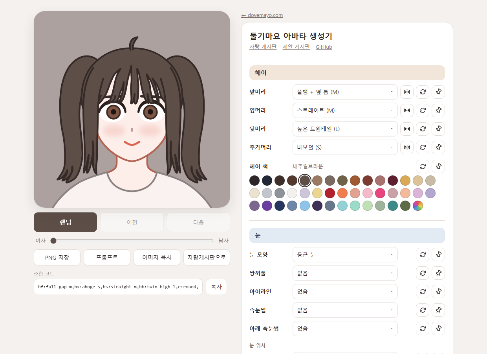
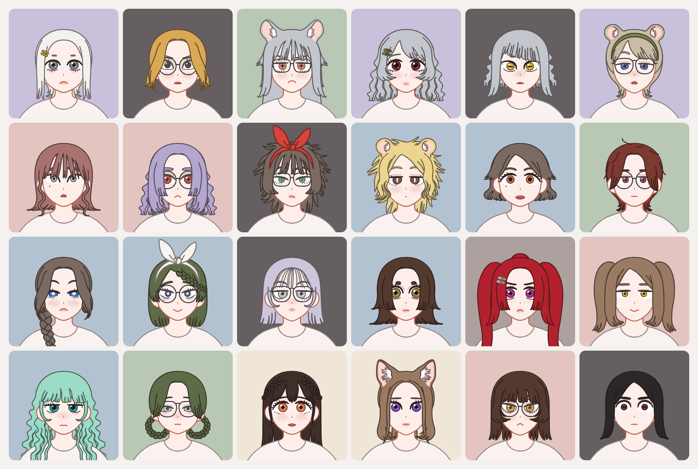

# 둘기마요 아바타 생성기

캐릭터 디자인 레퍼런스용 2D 아바타 얼굴 생성기입니다. 헤어·눈·얼굴·악세사리 파츠를 조합해 랜덤으로 뽑고, 항목마다 직접 고르거나 고정할 수도 있습니다. 결과는 PNG나 SVG로 저장하거나 이미지로 복사합니다.

바로 써 보기: **https://dovemayo.com/character/** · 자랑 게시판: https://dovemayo.com/character/show/





- 브라우저만으로 돌아갑니다. 설치할 패키지가 없습니다.
- 그림은 전부 `parts/` 폴더의 SVG 파일입니다. 파츠 하나 = 파일 하나라서 벡터 편집기로 고치고 빌드하면 바로 반영됩니다.
- 속눈썹, 쌍꺼풀, 아래 속눈썹, 애교살, 다크서클은 눈 파일의 아이라인을 따라 엔진이 자동으로 그립니다. 눈마다 따로 그릴 필요가 없습니다.

## 실행

| 방법 | 설명 |
|---|---|
| `index.html`을 브라우저로 열기 | 가장 간단한 방법. 서버 없이 바로 쓸 수 있습니다 |
| `start.bat` (또는 `node tools/server.js`) | 로컬 서버(`http://localhost:8765`, 이 컴퓨터에서만 접속)를 띄웁니다. SVG를 저장하면 자동으로 빌드하고 화면을 새로 고치며, 빌드 버튼과 항목 편집 창이 켜집니다. 파츠를 편집할 때 씁니다 |
| `build.bat` (또는 `node tools/build.js`) | `parts/`의 SVG를 `js/parts-data.js`로 묶습니다. 서버 없이 쓰는 중에 파츠를 고쳤다면 먼저 실행합니다 |
| `sheet.html` | 파츠를 한눈에 보는 확인용 시트. 주소 뒤에 `#front,back`처럼 항목을 적으면 그것만, `#random`은 랜덤 조합 모음, `big`은 크게, `guide`는 가이드 겹침 |

빌드와 서버에는 [Node.js](https://nodejs.org/)만 있으면 됩니다. 생성기 화면 자체는 Node.js 없이도 열립니다.

## 화면 기능

- **랜덤**: 고정하지 않은 항목을 전부 새로 뽑습니다(단축키 스페이스). 이전/다음(← →)으로 뽑은 기록을 오갑니다.
- **여자 ─ 남자 슬라이더**: 랜덤에서 남캐 쪽 파츠가 나올 비중입니다. 왼쪽 끝은 여캐 비중 그대로이고, 오른쪽으로 갈수록 짧은 머리·남캐에 어울리는 파츠가 자주 나옵니다(파츠마다 `_parts.json`의 `w`와 `wm`을 섞습니다).
- **항목별 조작**: 목록에서 고르기, `‹` `›`로 넘기기, 그 항목만 랜덤, 고정. 머리·악세사리는 좌우 반전, 한쪽만 그리기(왼쪽/오른쪽)도 됩니다.
- **색**: 헤어 43색, 눈 26색, 오드아이, 피부 11색, 악세사리 18색, 배경 7색과 투명. 색 줄 끝의 무지개 칸에서 원하는 색을 직접 고를 수도 있습니다.
- **커스텀 옵션**: 헤어·눈·악세사리 묶음 맨 아래의 접힌 칸. 랜덤으로는 바뀌지 않고 직접 고르는 항목입니다. 헤어는 `+ 머리 추가`로 앞머리·옆머리·뒷머리·추가머리를 하나 더(최대 4개), 악세사리는 `+ 악세사리 추가`로 헤어 악세사리·안경·귀걸이·마스크를 하나 더 얹습니다. 눈에는 흰자위 색과 오드아이가 있습니다.
- **조합 코드**: 지금 조합을 `hf:full-gap-m,hb:twin-low-m,f:round,...` 같은 문자열로 복사하고, 붙여 넣으면 다시 불러옵니다. 주소 뒤에 붙여(`index.html#hf:full-gap-m,e:fox`) 열 수도 있습니다. 파츠 이름을 바꿔도 예전 코드는 그대로 읽힙니다.
- **저장**: PNG 저장, SVG 저장, 이미지 복사(왼쪽 위에 `DOVEMAYO.COM`이 작게 들어간 이미지를 클립보드로. 복사가 막힌 브라우저에서는 파일로 저장).
- **자랑 게시판**: "자랑게시판으로"를 누르면 지금 캐릭터를 들고 게시판으로 가서 한 줄과 함께 올립니다. 게시판에는 조합 코드만 저장되고 얼굴은 페이지가 코드로 그립니다.
- **휴대폰**: 얼굴 카드가 화면 위에 붙어 있고, 카드 옆 아이콘으로 랜덤 / 이전 / 이미지 복사 / 자랑하기를 합니다. 랜덤 아래 세로 슬라이더가 여자 ─ 남자 비중입니다.
- **로컬 전용**(`start.bat`으로 열었을 때): 파츠마다 **파일** 버튼(지금 고른 SVG를 편집기로 열기), 빌드, 항목 편집, 3×3 샘플(고정 항목을 지킨 채 9명을 뽑아 PNG로 저장), 프롬프트(지금 캐릭터의 특징을 영어 문장·NovelAI 태그·한국어로), 옷(상의·외투·목 장식, 시험 중이라 홈페이지에는 아직 없음).

## 항목

| 묶음 | 항목 |
|---|---|
| 헤어 | 앞머리, 옆머리, 뒷머리, 추가머리(바보털·묶음·테일 등), 헤어 색 |
| 눈 | 눈 모양, 쌍꺼풀, 아이라인, 속눈썹, 아래 속눈썹 |
| | 눈 위치: 눈 크기, 눈 각도, 눈 간격, 눈 높이, 눈가(눈 밑 섀도 / 애교살 / 다크서클) |
| | 눈동자: 눈동자 크기, 눈동자 무늬, 하이라이트 |
| | 눈 색: 눈 색 |
| 얼굴 | 얼굴형, 피부색(처음엔 기본으로 고정), 피부특징, 볼터치 / 눈썹, 눈썹 간격·높이·각도 / 입, 입 높이, 코 높이, 립, 귀 모양 |
| 악세사리 | 헤어 악세사리, 안경, 귀걸이, 마스크·반창고, 악세사리 색 |
| 배경 | 배경 색 |

지금 그림 파츠는 앞머리 46, 옆머리 29, 뒷머리 64, 추가머리 17, 눈 14, 눈동자 무늬 14, 얼굴형 6, 귀 10, 눈썹 20, 입 19, 헤어 악세사리 7, 안경 7, 귀걸이 8개 등입니다.

화면의 묶음·소분류와 순서는 `js/core.js`의 `GROUPS`와 `LAYOUT`이 정합니다.

## 폴더 구조

```
index.html, css/style.css   생성기 화면
sheet.html                  파츠 확인용 시트
js/core.js                  조합 엔진 (DOM 없이 SVG 문자열을 만듭니다. Node에서도 돌아갑니다)
js/palettes.js              색 팔레트
js/app.js                   화면 동작 (랜덤, 고정, 이전/다음, 조합 코드, 저장, 항목 편집)
js/parts-data.js            빌드 결과물 (자동 생성, 직접 고치지 않습니다)
tools/build.js              parts/*.svg -> js/parts-data.js
tools/server.js             로컬 서버 + 빌드/항목 편집 API
tools/rename.js             파츠 이름 바꾸기 (예전 이름은 별칭으로 남김)
parts/                      그림 원본. 파츠 하나 = SVG 파일 하나
parts/README.md             파츠 편집 설명서 (그룹 이름 규칙, 기준 색 표)
fonts/                      복사한 이미지의 글자에 쓰는 둘기마요고딕(영문만)
docs/                       README용 화면 캡처
```

## 파츠 만들기·고치기

자세한 규칙은 [`parts/README.md`](parts/README.md)에 있습니다. 요점만 적으면 이렇습니다.

- **규격**: 캔버스 702×702, 좌우 대칭축 x=351.
- **대칭**: SVG 안의 그룹 이름이 `half`면 왼쪽만 그린 것으로 보고 엔진이 좌우 반전해 양쪽에 그립니다. `full`은 그린 그대로 한 번 그립니다. 다른 레이어에 놓을 조각은 `hairBack-half`처럼 레이어 이름을 붙입니다.
- **색**: 기준 색(피부색은 팔레트의 `hex`·`line`에서 볼터치·입술·코 색까지 정해집니다. 머리 `#5d4e48`, 머리 선 `#2b201d`, 피부 `#fdeeea`, 피부 선 `#b46352`, 눈동자 `#7e5647`, 입술 `#dc6450`, 악세사리 `#d8433b` 등)으로 칠하면 빌드가 CSS 변수로 바꿔, 생성기에서 고른 색이 들어갑니다. 다른 색은 그대로 나옵니다.
- **참고 레이어**: 이름이 `_`로 시작하는 그룹(`_ref` 등)은 빌드에서 빠집니다. 참고용 반투명 캐릭터를 여기에 둡니다.
- **목록**: 파일 이름이 파츠 id입니다(`front/full-gap-m.svg` → `full-gap-m`). 헤어는 `종류-특징-길이`(길이 `ss` `s` `m` `l` `ll`) 규칙을 따릅니다. 이름을 바꿀 때는 `node tools/rename.js <항목> <예전> <새>`를 쓰면 예전 조합 코드와 게시판 글이 깨지지 않습니다. 화면 이름, 순서, 랜덤 비중(`w`), 기본값은 같은 폴더의 `_parts.json`에 있고, `start.bat` 화면의 "항목 편집"에서도 고칠 수 있습니다. SVG를 넣고 빌드하면 목록 끝에 자동으로 붙습니다.
- **레이어 순서**(아래→위): `hairBack` → `body` → `cloth` → `skinNeck`(목) → `clothUp` → `hairMid` → `hairBase` → `ear` → `face` → `skin` → `makeup` → `skinTop` → `mouth` → `eye` → `hairLine` → `brow` → `glasses` → `hairFront` → `hairSide` → `hairTop` → `acc` (옆머리 조각을 앞머리 뒤로 보내려면 그룹 이름을 `back-half` 또는 `back-full`로. 뒷머리 파일에서는 목·몸 뒤로 갑니다)
- **머리카락**: 기본머리(`parts/base/hair.svg`)가 항상 깔리고, 얼굴 피부는 헤어라인 아래에만 칠해져 있습니다. 앞머리·옆머리는 그 위에(옆머리가 앞머리보다 위), 뒷머리는 그 뒤에 놓입니다. 내려오는 뒷머리는 `_parts.json`에 `"down": true`, 머리 윤곽보다 크게 감싸는 뒷머리는 `"noCap": true`를 줍니다.
- **눈**: 눈 파일에는 흰자(`white`), 윗 아이라인(`upper`, 검은 선), 아래 라인(`lower`, 노란 `#f5c400` 가이드 선), 눈동자 중심 표시(`iris`)만 그립니다.

새 항목(카테고리)을 추가하려면 `js/core.js`의 `CATEGORIES`, `tools/build.js`의 `CATEGORIES`와 `GENERIC`(그림 항목) 또는 `DATA_ONLY`(수치 항목), 수치 항목이면 `tools/server.js`의 `DATA_ONLY`까지 세 곳을 고칩니다.

## 엔진만 쓰기 (Node)

`js/core.js`는 DOM 없이 SVG 문자열을 만들므로 Node에서 그대로 쓸 수 있습니다.

```js
const vm = require('vm');
const fs = require('fs');

const ctx = {};
vm.createContext(ctx);
for (const f of ['js/core.js', 'js/palettes.js', 'js/parts-data.js']) {
  vm.runInContext(fs.readFileSync(f, 'utf8'), ctx, { filename: f });
}
const CG = ctx.CG;

const state = CG.randomState();              // 랜덤 조합
fs.writeFileSync('out.svg', CG.compose(state)); // SVG 문자열
console.log(CG.encode(state));               // 조합 코드
```

그 밖에 `CG.defaultState()`, `CG.decode(code)`, `CG.parts`, `CG.palettes`, `CG.categories` 등을 씁니다.

## 라이선스

코드와 파츠 그림은 [MIT](LICENSE)입니다. `fonts/`의 둘기마요고딕은 MIT 대상이 아니며 둘기마요의 폰트 이용 조건을 따릅니다.
